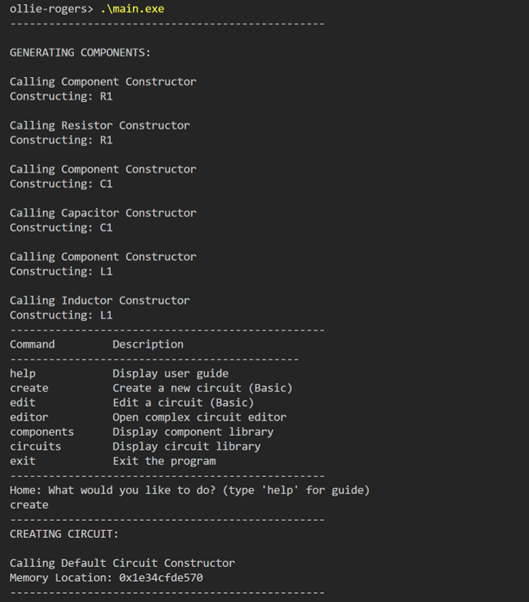
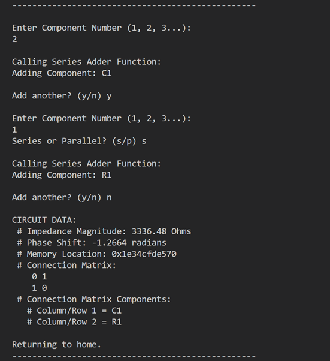
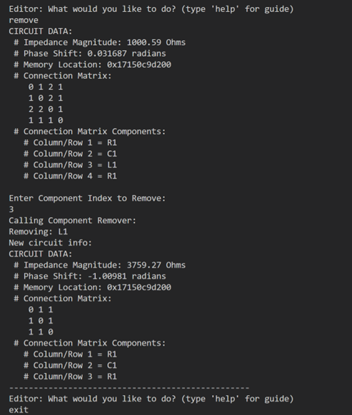

# AC Circuit Simulator

Object-oriented C++ application for modelling and analysing AC electrical circuits.

## Overview

This project allows users to construct, modify and analyse arbitrary AC circuit configurations through a console-based interface. Users can build series and parallel circuits using a range of electrical components, with impedance and phase shift recalculated automatically whenever changes are made to the circuit.

The project was developed as the final assignment for a third-year university module in Object-Oriented Programming using C++.

## Features

- Create custom AC circuit configurations
- Add and remove circuit components
- Edit existing component values
- Support for series circuit arrangements
- Support for parallel circuit arrangements
- Automatic impedance calculations
- Automatic phase shift calculations
- Interactive console-based user interface
- Object-oriented software design

## Technologies

- C++
- Object-Oriented Programming (OOP)
- Makefile Build System

## Running the Application

### Compile

```bash
mingw32-make
```

### Run

```bash
.\main.exe
```

## Using the Application

Instructions for using the application can be found in the accompanying project report.

The application also contains built-in user guides for both the Home and Editor menus, accessible through dedicated guide functions implemented within the source code.

## Example Usage

The screenshots below demonstrate the creation and modification of AC circuits through the console interface.

### Creating a Circuit



*Initial application workflow showing the process of creating a new AC circuit and navigating the simulator interface.*

### Adding Components



*Example demonstrating the addition of multiple circuit components and the construction of more complex series and parallel circuit configurations.*

### Removing Components



*Example demonstrating the removal of an existing component and the automatic recalculation of circuit properties.*

## Skills Demonstrated

- Object-Oriented Programming
- Software Design
- C++ Development
- Mathematical Modelling
- Problem Solving
- Scientific Computing

## Project Context

This project was developed as part of a third-year university module in Object-Oriented Programming using C++. The objective was to apply object-oriented design principles to create a maintainable and extensible simulation of AC electrical circuits.
