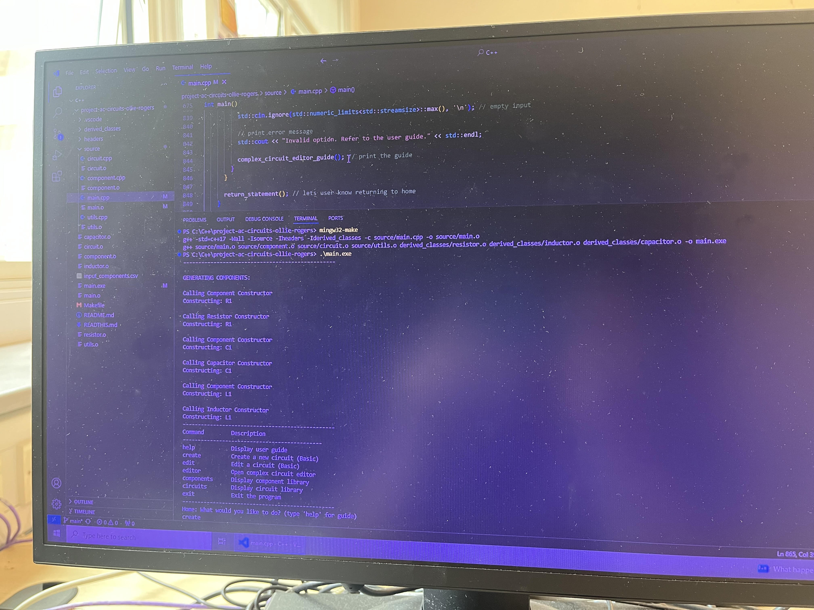

TO COMPILE THE CODE  (using makefile) PLEASE ENTER:

mingw32-make

TO RUN THE CODE PLEASE ENTER:

.\main.exe

EVIDENCE OF COMPILATION ON LAB COMPUTER:

ABOUT THE CODE: 

Instructions for how to use the code are given in the report. Additionally, you can find user guides for both "Home" and the "Editor". These are printed by clear and easy to read "guide" functions in the main.cpp file in the code.
